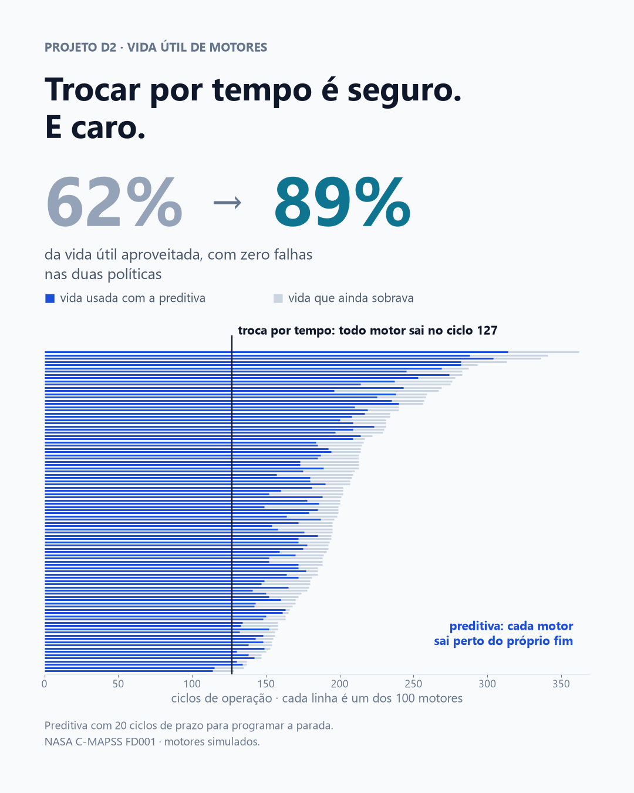

# Trocar por tempo é seguro — e joga fora 38% da vida útil

**Com zero falhas nas duas políticas, a troca por tempo fixo aproveita 62% da vida
útil dos motores. Trocar quando o modelo prevê o fim de cada um aproveita 89% —
mesmo com 20 ciclos de prazo para programar a parada.**



## A pergunta

Quanta vida útil se desperdiça trocando equipamento por tempo fixo, quando a vida
varia muito de uma unidade para outra? E quanto dá para aproveitar prevendo o fim
de cada uma, sem aumentar o risco de falha?

É o par do [projeto D1](https://github.com/GoveiaDev/d1-previsao-falhas-fresadora).
Lá, as falhas por desgaste da ferramenta aconteciam numa janela estreita — entre 198
e 253 minutos de uso, o maior valor só 1,28 vez o menor — e a troca preventiva por
tempo resolvia. Aqui, o motor que mais durou durou **2,8 vezes** o que menos durou.

## Os dados

[C-MAPSS — Turbofan Engine Degradation Simulation](https://www.nasa.gov/intelligent-systems-division/discovery-and-systems-health/pcoe/pcoe-data-set-repository/),
NASA Prognostics Center of Excellence. Subconjunto **FD001**: 100 motores rodados
até a falha (20.631 ciclos registrados), com 21 sensores e uma condição de operação,
mais 100 motores de teste interrompidos antes da falha, com a vida restante real
informada. Cada registro é um ciclo de operação de um motor.

A vida útil dos 100 motores vai de **128 a 362 ciclos** (mediana 199).

## O que eu fiz

Um Random Forest prevê a vida restante a cada ciclo, a partir dos 15 sensores que
variam e das suas médias móveis de 10 e 30 ciclos. A validação separa por motor: o
modelo nunca prevê um motor que viu no treino. No teste oficial da NASA, o erro típico
(RMSE) é de **16,4 ciclos**.

Depois, simulei duas políticas nos 100 motores:

- **Troca por tempo fixo:** todo motor sai de operação no mesmo ciclo.
- **Troca preditiva:** o alarme dispara quando a vida restante prevista cai abaixo de
  uma margem, e a intervenção acontece **20 ciclos depois do alarme** — o prazo para
  programar a parada. Esse prazo foi fixado antes de ver os resultados; sem ele, a
  comparação favoreceria a preditiva de forma injusta.

Cada política recebe o seu melhor ajuste para o mesmo nível de risco:

| Risco aceito (falhas em 100) | Tempo fixo: desperdício por motor | Preditiva: desperdício por motor |
|---|---|---|
| 0 | 79,3 ciclos (troca no ciclo 127) | **23,4 ciclos** |
| 2 | 71,8 ciclos | **18,7 ciclos** |
| 5 | 63,3 ciclos | **16,9 ciclos** |

**Teste de robustez:** 200 vezes, a regra de zero falhas foi escolhida em 50 motores
sorteados e aplicada nos outros 50. Em motores que a regra nunca viu, a troca por
tempo teve 1,6 falha em cada 100 e desperdiçou 77,0 ciclos; a preditiva, 1,2 falha
e 21,6 ciclos. A diferença se mantém.

## O que isso significa

**Janela estreita, preventiva por tempo. Janela larga, preditiva.** Juntos, D1 e D2
formam uma regra de decisão. A troca por tempo precisa ser cedo o bastante para
proteger a unidade que dura menos — e quando a vida varia muito, todas as outras saem
com vida sobrando. No FD001, a data fixa que evita qualquer falha é o ciclo 127, mas
a vida média é de 206.

**O que se ganha é vida útil, não segurança.** As duas políticas chegam a zero falha.
A diferença está em quanto de cada motor é aproveitado antes da troca: 62% contra 89%.
Em equipamento caro, com peça de reposição cara, é aí que está o dinheiro.

**O primeiro passo é medir a dispersão, não comprar sensor.** Antes de investir em
preditiva, vale olhar o histórico de vida útil do equipamento. Se a vida é parecida
de uma unidade para outra, a troca por tempo faz o serviço. Se varia muito, a preditiva
se paga.

## Limitações

- **Os motores são simulados.** O C-MAPSS vem de um modelo de motor turbofan da NASA,
  com um único modo de falha (degradação do compressor de alta pressão) e uma única
  condição de operação. Equipamento real tem vários modos de falha, manutenções
  parciais no meio da vida e ruído de sensor que a simulação não tem.
- **Calibração nos mesmos motores.** A tabela principal escolhe a regra e mede nos
  mesmos 100 motores, o que é otimista para as duas políticas. O teste de robustez
  mostra que, em motores novos, as duas passam a ter 1 a 2 falhas em cada 100.
- **Prazo de ação fixo em 20 ciclos.** Um prazo maior exige margem maior e aumenta o
  desperdício da preditiva.
- **Custo fora da conta.** O desperdício está em ciclos, não em reais. Monitorar
  sensores tem custo, e parada programada também. A decisão real compara vida útil
  aproveitada com o custo de manter o monitoramento.
- **Vida restante limitada a 125 ciclos no treino.** O modelo não diferencia motores
  muito longe do fim — o que não afeta a decisão de parar, tomada na reta final.
- **Só o FD001.** Os subconjuntos com várias condições de operação e dois modos de
  falha (FD002 a FD004) são mais difíceis e ficaram de fora.

## Como rodar

```bash
python -m venv .venv
.venv/Scripts/pip install pandas numpy scikit-learn matplotlib jupyter
```

Baixe o zip na [página de datasets do NASA PCoE](https://www.nasa.gov/intelligent-systems-division/discovery-and-systems-health/pcoe/pcoe-data-set-repository/)
(item 6, *Turbofan Engine Degradation Simulation*, 12 MB). Dentro dele há um segundo
zip, `CMAPSSData.zip`: extraia `train_FD001.txt`, `test_FD001.txt` e `RUL_FD001.txt`
para a pasta `dados/` e rode:

```bash
.venv/Scripts/jupyter nbconvert --to notebook --execute --inplace analise.ipynb
```

O notebook [`analise.ipynb`](analise.ipynb) já está salvo com as saídas executadas —
dá para ler sem rodar nada. A semente aleatória é fixa (42).

---

Ramon Goveia · [linkedin.com/in/ramon-goveia-92266443](https://www.linkedin.com/in/ramon-goveia-92266443) · projeto D2 de 16 do portfólio
